# Screenshot gallery

Every image on this page is a live capture from an Aether virtual machine. They
are not mockups, design renders or staged dialogs. The complete set, capture
notes and provenance are in [`media/README.md`](../media/README.md); the files
live under [`media/screenshots/`](../media/screenshots/).

## Desktop

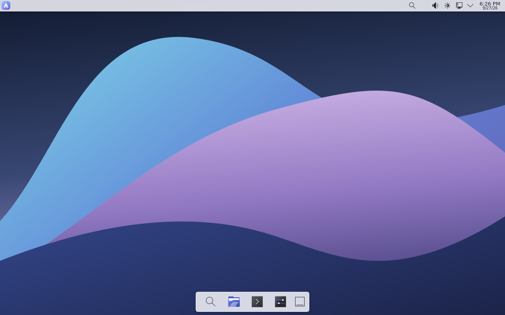

Aether 0.3 on KDE Plasma. The panel, wallpaper, colour scheme and application
menu are the ones shipped in the image.

<table>
  <tr>
    <td width="50%">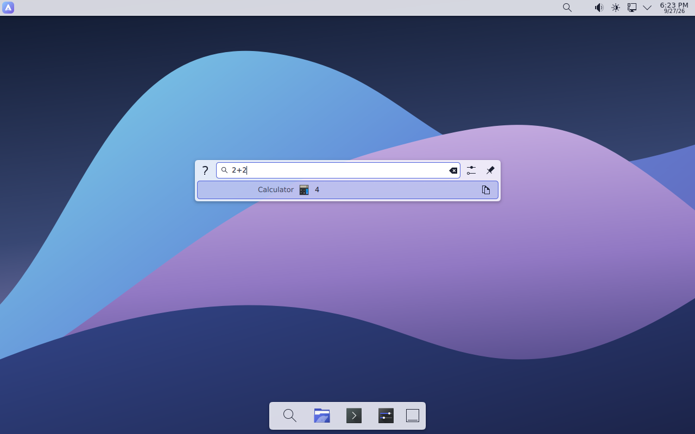</td>
    <td width="50%">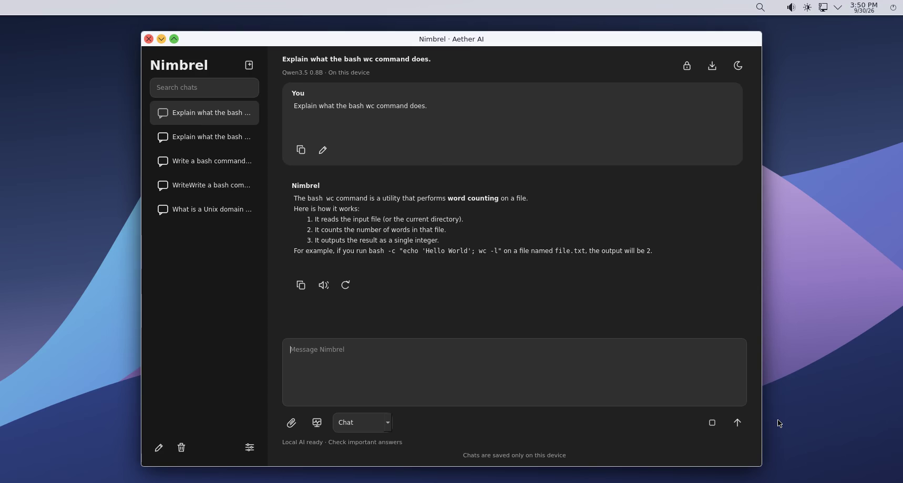</td>
  </tr>
  <tr>
    <td><strong>AuraSearch</strong>: applications, files and settings, with inline calculations.</td>
    <td><strong>Nimbrel</strong>: an on-device answer from the small local model. The answer is shown unedited.</td>
  </tr>
</table>

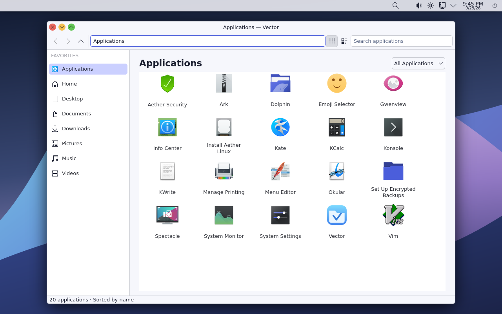

Vector, the file and application browser, showing the installed application
grid.

## Sign-in and session

<table>
  <tr>
    <td width="50%">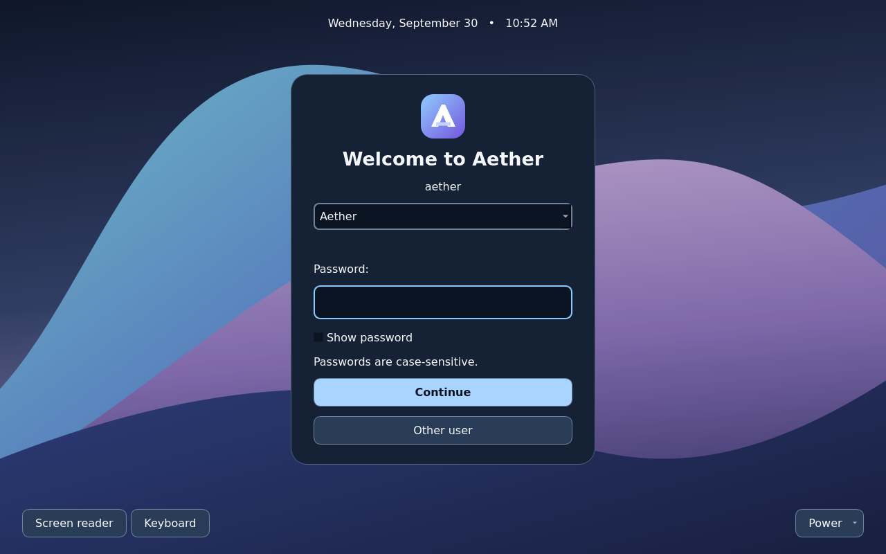</td>
    <td width="50%">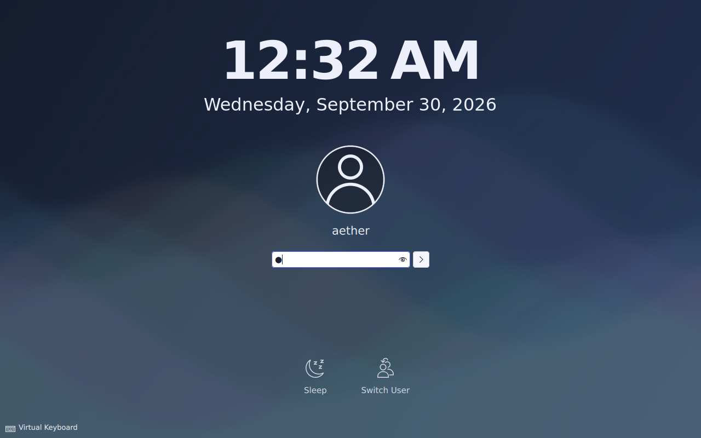</td>
  </tr>
  <tr>
    <td>The greeter. Password fields in this gallery are empty or masked.</td>
    <td>The lock screen after a session is locked.</td>
  </tr>
</table>

## Installation

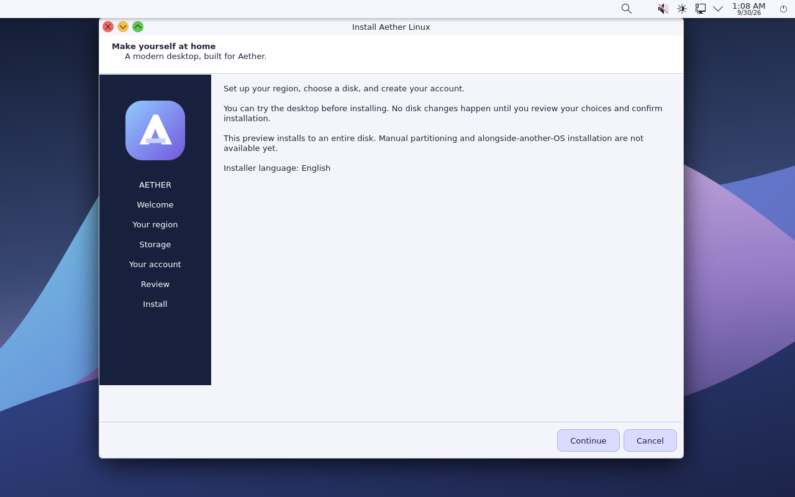

The installer states its whole-disk limitation before anything is changed.

<table>
  <tr>
    <td width="50%">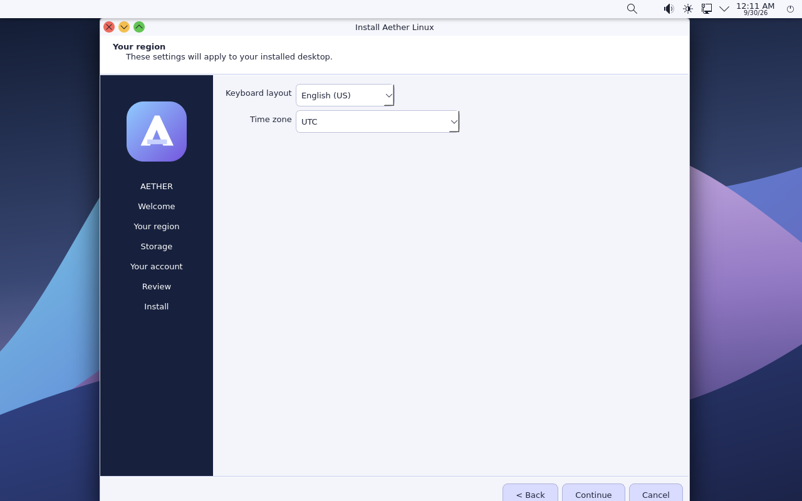</td>
    <td width="50%">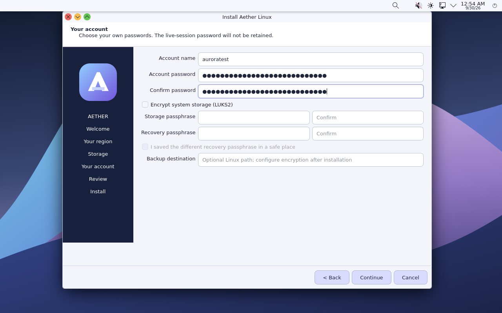</td>
  </tr>
  <tr>
    <td>Region, keyboard and time zone.</td>
    <td>Account, LUKS2 storage passphrase and separate recovery passphrase.</td>
  </tr>
  <tr>
    <td>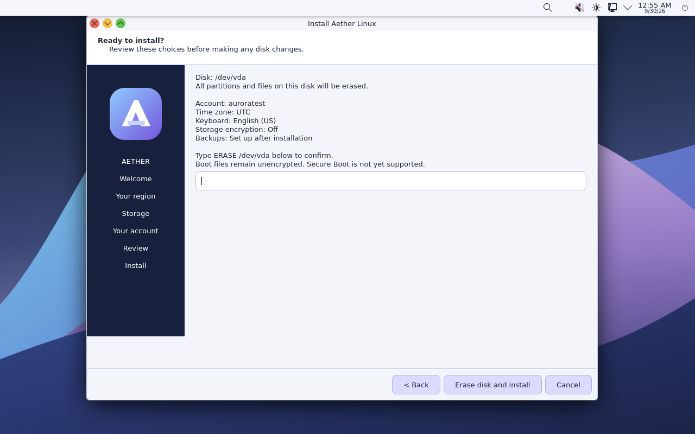</td>
    <td>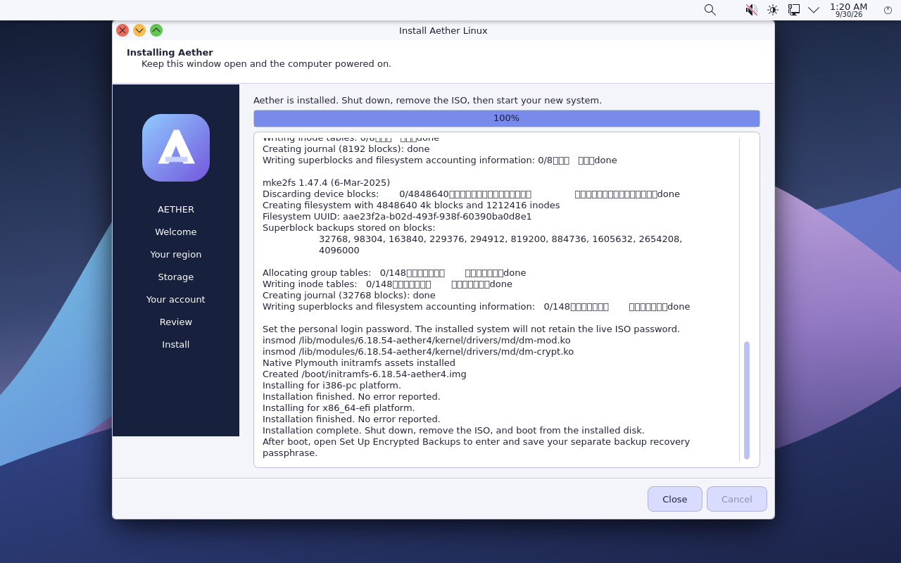</td>
  </tr>
  <tr>
    <td>Review requires the exact <code>ERASE /dev/…</code> confirmation.</td>
    <td>The installed bootloader and the finished installation.</td>
  </tr>
</table>

## Encryption and security

<table>
  <tr>
    <td width="50%">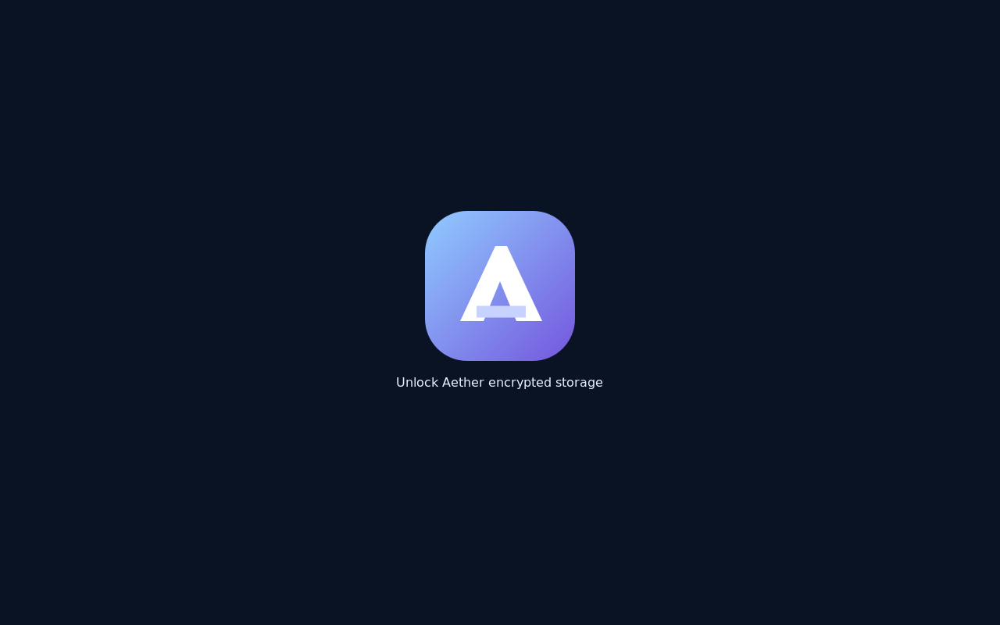</td>
    <td width="50%">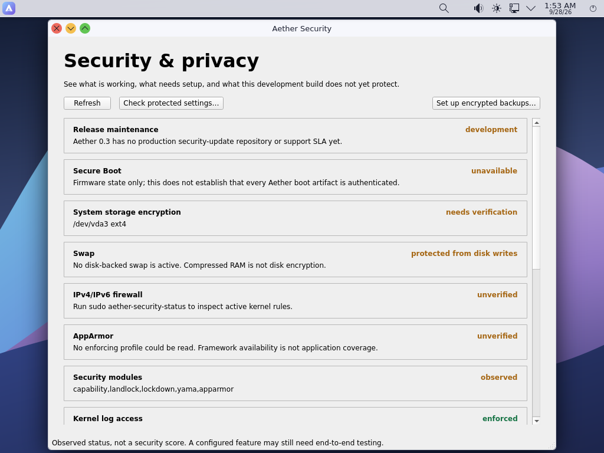</td>
  </tr>
  <tr>
    <td>LUKS2 unlock for the encrypted root filesystem.</td>
    <td>Security Center separates what is protected, unverified and unsupported.</td>
  </tr>
</table>

The encrypted-root install protects the root filesystem. The EFI system
partition and `/boot` remain unencrypted in the current released image; this
gallery does not claim otherwise. See
[Secure Boot and encrypted roots](secure-boot.md#limits).

## Boot and first start

<table>
  <tr>
    <td width="50%">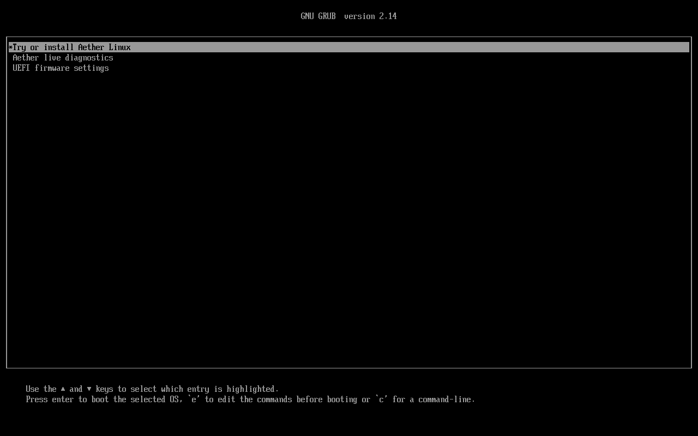</td>
    <td width="50%">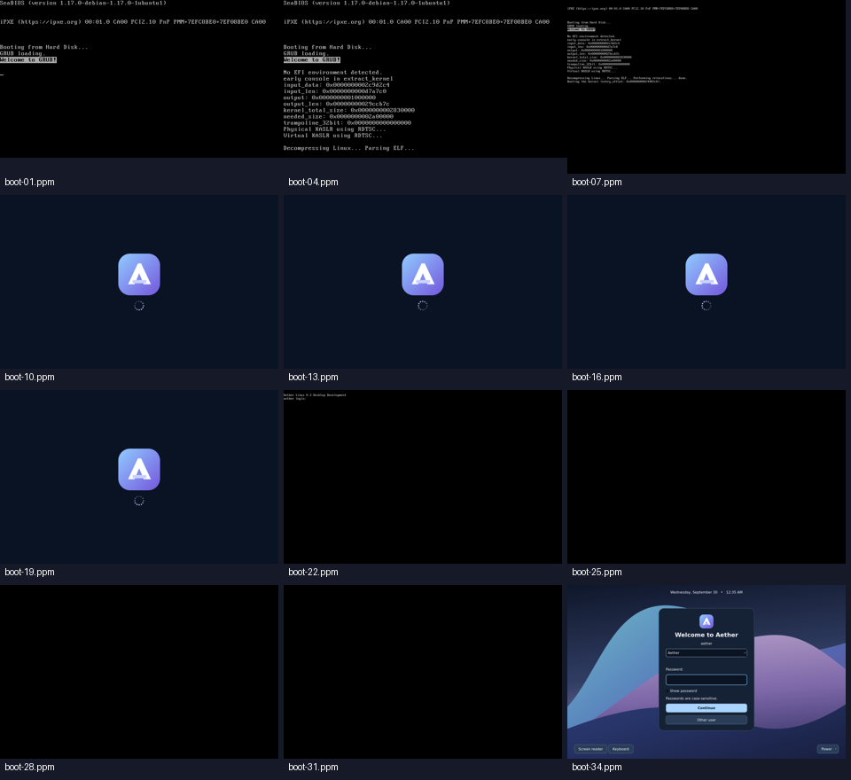</td>
  </tr>
  <tr>
    <td>The UEFI GRUB menu.</td>
    <td>The Plymouth boot splash.</td>
  </tr>
</table>

First start from the installed disk.

## What these images do and do not prove

- They were captured from the running guest framebuffer, not from a separate
  design tool.
- They show the interface as it appeared. They do not certify every feature in
  every environment.
- They contain no passwords, tokens or private keys. The installer account name
  visible in an installation capture is a throwaway test account.
- Virtual-machine captures are not physical-hardware certification. See the
  [physical Secure Boot test plan](secure-boot-physical-test-plan.md).
